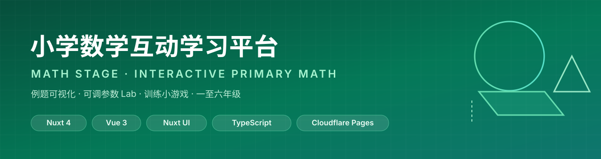
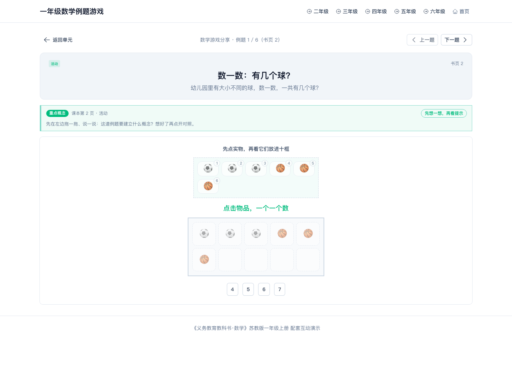
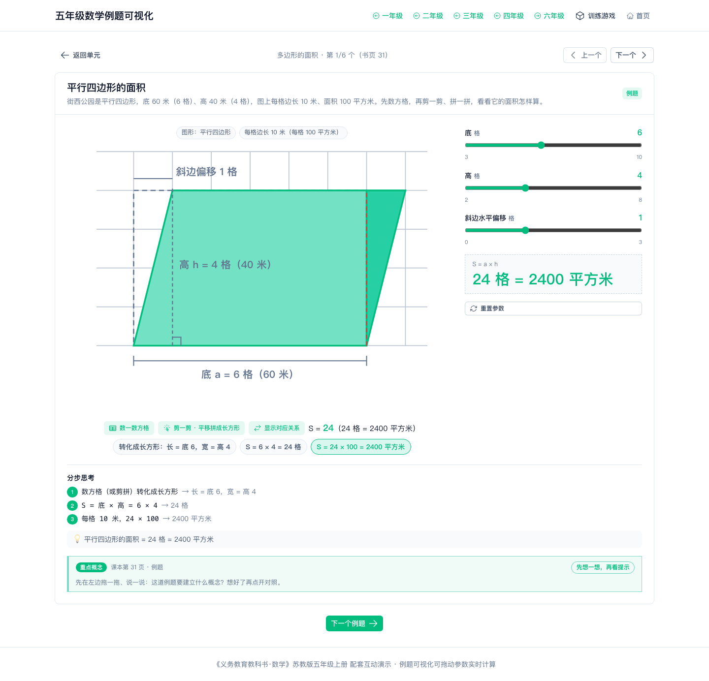
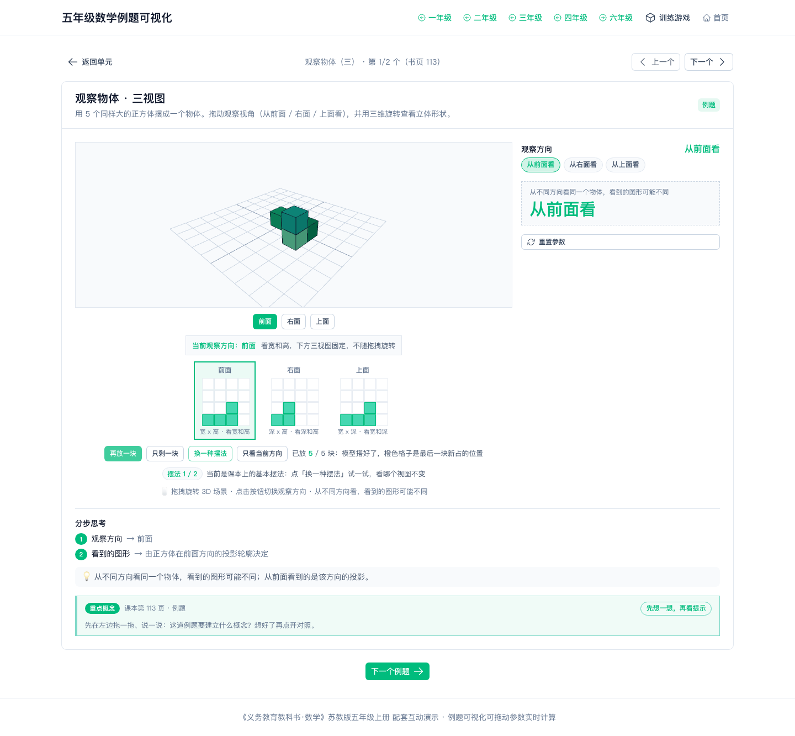
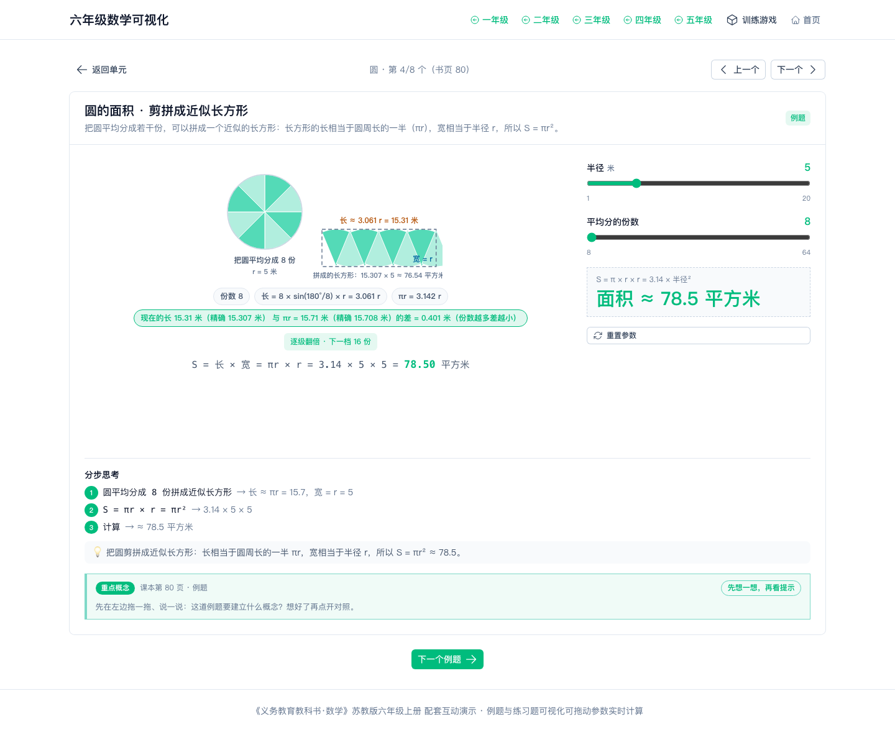

<p align="center">
  
</p>

<h1 align="center">Math Stage · Interactive Primary Math</h1>

<p align="center">
  Turning every worked example in the primary-school math textbook into an interactive, parameter-driven Lab and game set.<br>
  <sub>Jiangsu Phoenix Education Press · 2022 curriculum standards · Nuxt 4 static site · one Cloudflare Pages deployment</sub>
</p>

<p align="center">
  <a href="https://github.com/tesths/math-stage/actions/workflows/ci.yml"></a>
  <a href="LICENSE"></a>
  
  
  
  
  <a href="CONTRIBUTING.md"></a>
</p>

<p align="center">
  <a href="README.md">简体中文</a> · <b>English</b>
</p>

---

> [!NOTE]
> **Project status**: This project is still a work in progress. Much of the content was produced with AI
> assistance and still needs ongoing maintenance and refinement. We open-sourced it in the hope that it
> helps teachers with lesson preparation and classroom demonstrations — contributions and fixes are welcome.

## What is this?

**Math Stage** is an interactive math learning site for grades 1–6. It reworks each textbook worked example from a *static figure + text* into a **parameter-driven lab**: drag the base, height, radius, time, price and other parameters, and the figure, formula and computation update in real time — so students can see *why* a method works.

The project is organised as **seven Nuxt 4 apps** (grades 1–6 plus a portal) that share one design system and are aggregated into a single static artifact, deployable with **one Cloudflare Pages project**.

- 🧮 **171 parameter-driven visualization Labs** (grades 2–6) plus 78 answer-game examples for grade 1
- 🎮 **80 training mini-games** with randomized questions for repeated practice
- 📐 Covers number & algebra, geometry, statistics & probability, and integrated practice
- 📱 Fully static, pre-rendered, mobile-friendly, no backend required

## ✨ Features

| Capability | Description |
| --- | --- |
| Parameterized visualization | Each Lab drives SVG, Canvas or three.js scenes from sliders/options, keeping figure and formula in sync |
| Step-by-step reasoning | Every example offers a "think first → then reveal" walkthrough and conclusion for classroom use |
| Textbook alignment | Each item records its textbook page and source (worked example / practice / exercise / activity) |
| Training games | Unit-organized randomized practice covering mental math, long division, unit conversion, shape recognition and more |
| Responsive & accessible | Mobile adaptation, keyboard support, unified design tokens, no external font dependency |
| One-command deploy | One repo, one build, one Pages project; `npm run build:site` produces `deploy/` |

## 🎓 Content by grade

| Grade | Textbook (2022 standards) | Interactive content |
| --- | --- | --- |
| Grade 1 | Jiangsu Phoenix · Vol. 1 | 9 units · **78 answer-game examples** + **20 textbook-themed mini-games** |
| Grade 2 | Jiangsu Phoenix · 2025 edition · Vol. 1 | **22 Labs** (multiplication tables, tangram, abacus, place value, directions, RMB…) + **12 games** |
| Grade 3 | Jiangsu Phoenix · Vol. 1 | **41 Labs** (24-hour clock, written methods, three-view via three.js, segment diagrams…) + **16 games** |
| Grade 4 | Jiangsu Phoenix · Vol. 1 | **28 Labs** (long-division trial quotient, perimeter & area, place-value chart, large numbers…) + **10 games** |
| Grade 5 | Jiangsu Phoenix · Vol. 1 | **33 Labs** (three-view, Chart.js statistics, polygon-area dissection…) + **10 games** |
| Grade 6 | Jiangsu Phoenix · Vol. 1 | **47 Labs** (33 examples + 14 exercises: decimal grid model, circle & sector, binary, golden ratio…) + **12 games** |

> See [`g1/README.md`](g1/README.md) … [`g6/README.md`](g6/README.md) for per-grade details (Chinese).

## 🖼️ Screenshots

<table>
  <tr>
    <td align="center"><br><sub>Grade 1 · counting game</sub></td>
    <td align="center"><br><sub>Grade 5 · parallelogram area (dissection)</sub></td>
  </tr>
  <tr>
    <td align="center"><br><sub>Grade 5 · three-view with three.js</sub></td>
    <td align="center"><br><sub>Grade 6 · circle area (rearranged into a rectangle)</sub></td>
  </tr>
</table>

## 🧭 Repository layout

```text
math-stage/
├── README.md / README.en.md   Chinese / English docs (this file)
├── LICENSE / NOTICE           MIT license / textbook copyright notice
├── docs/                      Documentation hub (index: docs/README.md)
├── shared/                    Shared design system (grade registry / theme tokens / GradeShell)
├── portal/                    Portal home (Nuxt 4)
├── g1/ … g6/                  Per-grade projects
│   ├── data/{upper,lower}/    Structured example / Lab data
│   ├── ocr/{upper,lower}/     Textbook OCR (text + full-page images + crops)
│   └── game/                  Nuxt 4 app
├── scripts/                   Aggregated build, OCR, verification, screenshot regression
└── package.json               Root workspace (Node 24 + npm workspaces)
```

Each grade keeps its own project boundary, while dependencies and build entry points live at the repo root with a single `package-lock.json`.

## 🛠 Tech stack

- **Framework**: Nuxt 4 (`srcDir: src/`) + Vue 3 + vue-router
- **UI**: Nuxt UI v4 with an emerald primary color, offline fonts and local icon sets
- **Visualization**: three.js, Chart.js, Anime.js v4, hand-drawn SVG, jsxgraph (fallback)
- **Quality**: Vitest (unit/component) + Playwright (E2E) + `vue-tsc`
- **Deploy**: Nitro `cloudflare-pages` preset, aggregated static export
- **Runtime**: Node 24 (`.nvmrc` / `.node-version`), npm ≥ 11 workspaces

## 🚀 Getting started

Requirements: **Node 24** (`>=24 <25`) and **npm ≥ 11**. The root enables `engine-strict`, so a mismatch fails fast.

```bash
# 1) Clone and install (dependencies install once at the repo root)
git clone https://github.com/tesths/math-stage.git
cd math-stage
npm ci --ignore-scripts

# 2) Run one grade locally (grade 5 shown)
npm run dev --workspace math-game-g5
# or: cd g5/game && npm run dev

# 3) Build and preview the full site (portal + six grades → deploy/)
npm run build:site:local
npx serve deploy          # open http://localhost:3000
```

> If npm needs a proxy, set `HTTP_PROXY` / `HTTPS_PROXY` for the install only; the `prepare` / `generate`
> scripts automatically clear proxy variables so `socks5h://` is not misread by Undici.

## 🧪 Testing

```bash
npm run typecheck       # prepare all seven Nuxt apps, then full typecheck
npm run test:unit       # unit/component tests across all workspaces
npm run test:shared     # shared layer (100% coverage)
npm run test:coverage   # aggregated coverage

# Single grade
cd g5/game && npm run test && npm run test:coverage
cd g5/game && npm run test:e2e

# Post-deploy checks (run `npm run build:site:local` first)
npm run test:click      # real click-through acceptance
node scripts/link-audit.mjs --live   # live full-site link audit
```

## 📦 Deployment

One GitHub repo, **one** Cloudflare Pages project: the portal at `/`, grades 1–6 at `/g1/` … `/g6/`.

| Setting | Value |
| --- | --- |
| Build command | `npm run build:site` |
| Build output directory | `deploy` |
| Framework preset | None |

Pushing to `main` triggers a build. Full dashboard steps, parameters and troubleshooting: [`docs/DEPLOYMENT.md`](docs/DEPLOYMENT.md) (Chinese).

## 📚 Documentation

Documentation lives in [`docs/`](docs/), starting from [`docs/README.md`](docs/README.md). Highlights:

| Document | Contents |
| --- | --- |
| [`docs/DEVELOPMENT.md`](docs/DEVELOPMENT.md) | Architecture, data formats, how to add a Lab / game / grade, OCR pipeline, tests, troubleshooting |
| [`docs/DEPLOYMENT.md`](docs/DEPLOYMENT.md) | Single-Pages deployment in depth, parameter tables, post-deploy checklist |
| [`docs/example-audit-glm.md`](docs/example-audit-glm.md) | Cross-check report of 235 examples against GLM-OCR |
| [`docs/example-visual-review.md`](docs/example-visual-review.md) | Per-example visual review (screenshots, issues, fixes, priority) |
| [`docs/example-visual-improvements.md`](docs/example-visual-improvements.md) | Grade 5–6 improvement log (what changed, why, how verified) |

## 🤝 Contributing

Issues, PRs and teaching suggestions are welcome. Please read:

- [CONTRIBUTING.md](CONTRIBUTING.md) — environment, branch/commit conventions, adding an example / Lab / game
- [CODE_OF_CONDUCT.md](CODE_OF_CONDUCT.md)
- [SECURITY.md](SECURITY.md)
- Changelog: [CHANGELOG.md](CHANGELOG.md)

**Good first contributions**: writing "key concept" notes for examples, fixing figure details, adding training mini-games, improving accessibility and mobile experience, docs and English translation.

## ⚖️ License & copyright

- **Source code** is licensed under the [MIT License](LICENSE), Copyright © 2026 tesths.
- **Textbook content** (scans, OCR text, merged book Markdown, and data derived from the examples) remains the
  copyright of its authors/publishers and is **not covered by the MIT License**. It is provided for educational
  research and learning only, and must not be used commercially or redistributed. See [NOTICE](NOTICE).

> This project is not affiliated with any publisher; textbook content is used for teaching demonstration only.
> If you are a rights holder with concerns, please open an Issue and we will respond promptly.

## 🙏 Acknowledgements

- Framework & UI: [Nuxt](https://nuxt.com), [Vue](https://vuejs.org), [Nuxt UI](https://ui.nuxt.com)
- Visualization: [three.js](https://threejs.org), [Chart.js](https://www.chartjs.org), [Anime.js](https://animejs.com), [jsxgraph](https://jsxgraph.org)
- README and open-source conventions follow [KaTeX](https://github.com/KaTeX/KaTeX), [Manim](https://github.com/3b1b/manim) and [Nuxt](https://github.com/nuxt/nuxt), plus [Contributor Covenant](https://www.contributor-covenant.org/), [Keep a Changelog](https://keepachangelog.com/) and [Choose a License](https://choosealicense.com/)

---

<p align="center"><sub>If this project helps your teaching, a ⭐ Star is appreciated.</sub></p>
