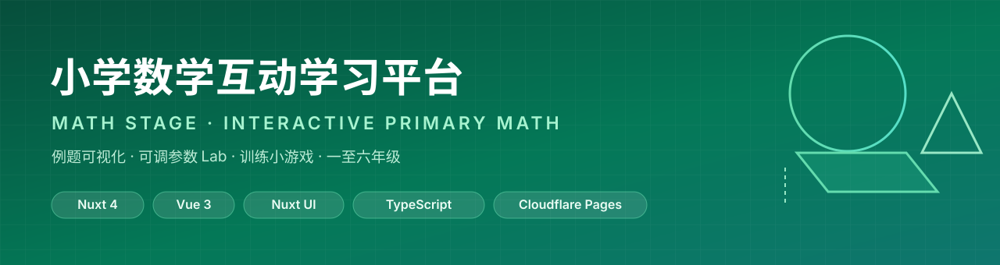
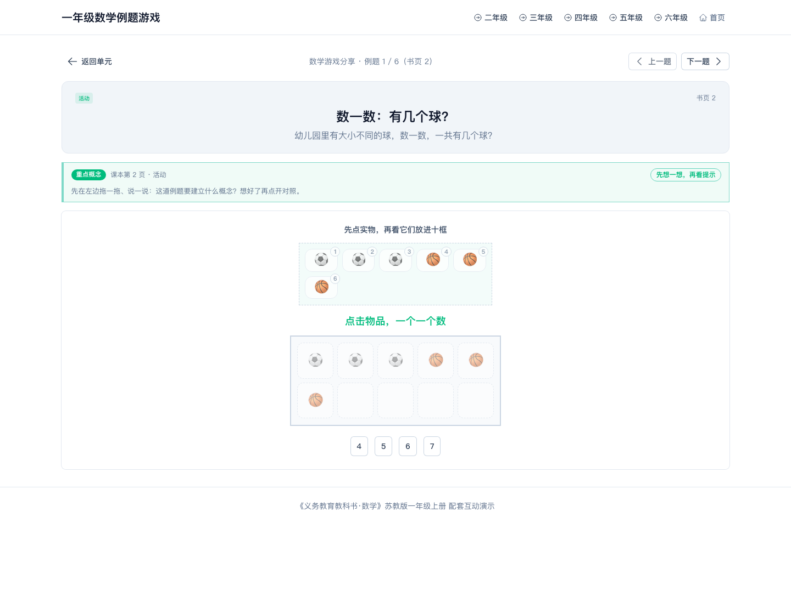
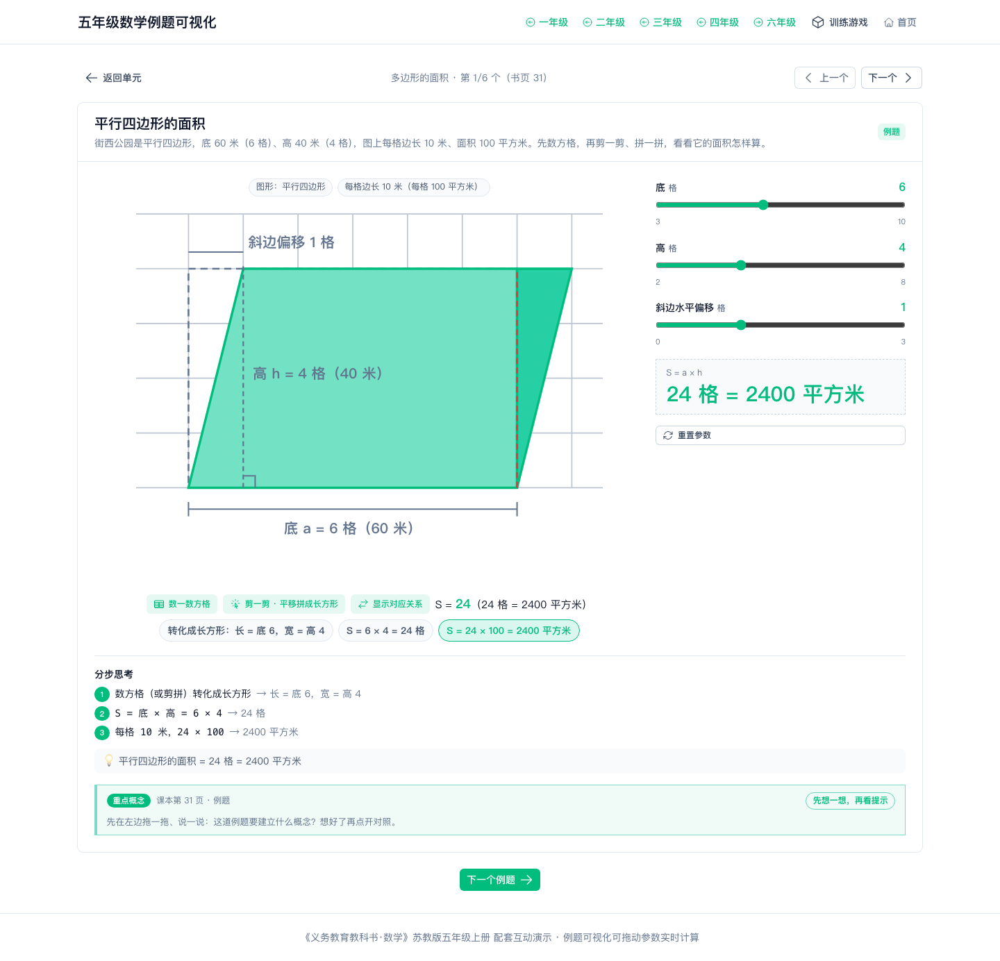
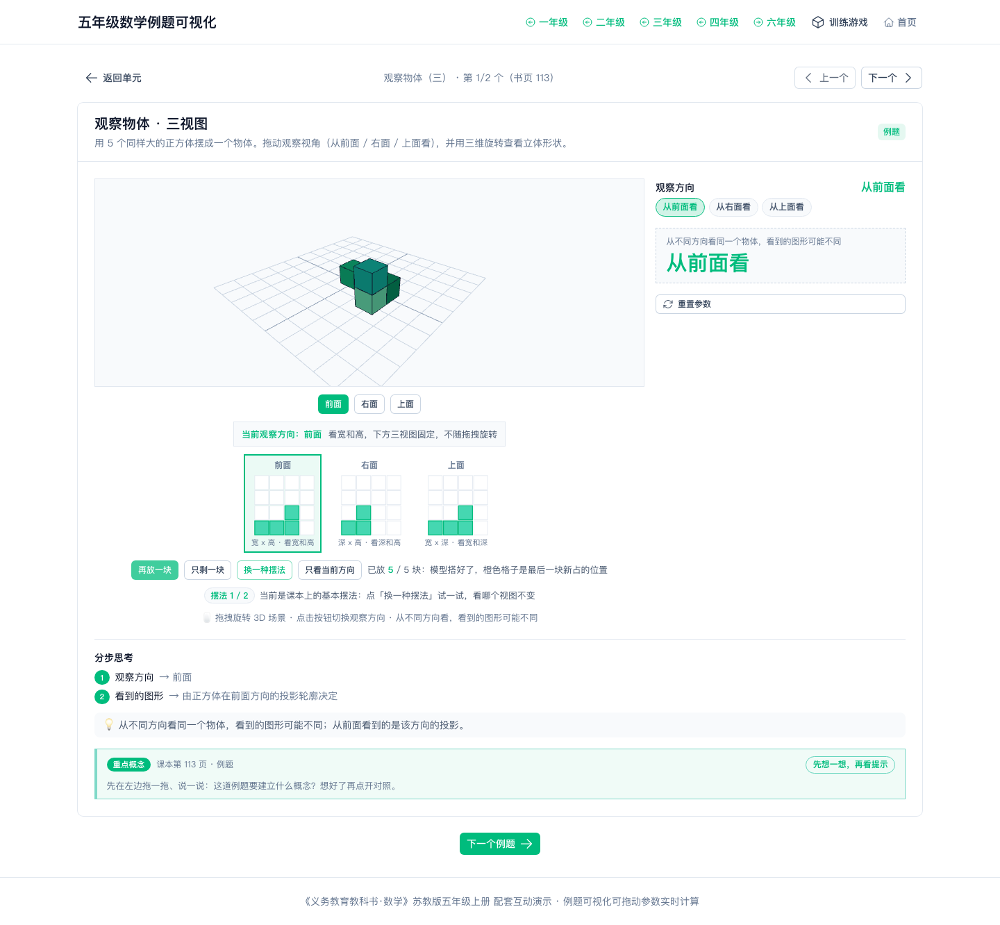
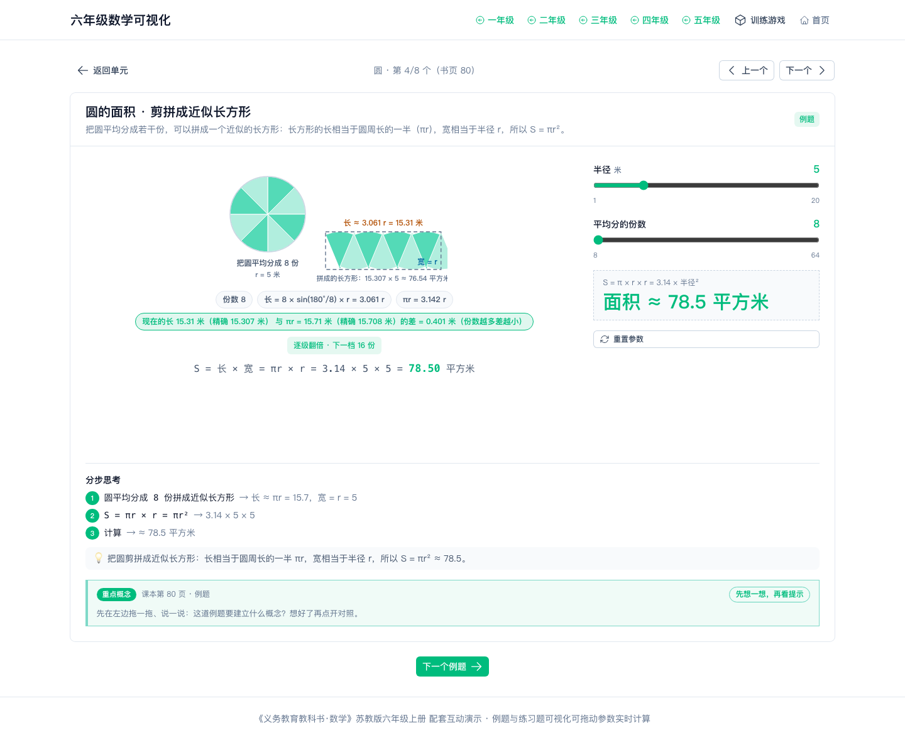

<p align="center">
  
</p>

<h1 align="center">小学数学互动学习平台 · Math Stage</h1>

<p align="center">
  把一至六年级的数学课本例题做成「可拖动参数、实时联动」的互动可视化 Lab 与小游戏。<br>
  <sub>苏教版 · 2022 版课标 · Nuxt 4 静态站点 · 单 Cloudflare Pages 聚合部署</sub><br>
  🌐 在线体验：<a href="https://math-stage.dididigu.com/">math-stage.dididigu.com</a>
</p>

<p align="center">
  <a href="https://math-stage.dididigu.com/"></a>
  <a href="https://github.com/tesths/math-stage/actions/workflows/ci.yml"></a>
  <a href="LICENSE"></a>
  
  
  
  
  <a href="CONTRIBUTING.md"></a>
</p>

<p align="center">
  <b>简体中文</b> · <a href="README.en.md">English</a>
</p>

---

> [!NOTE]
> **项目现状**：本项目仍在持续完善中，目前内容主要由 AI 主导完成，仍有不少细节需要继续维护与更新。
> 之所以开源，是希望对一线老师的备课与课堂演示有所帮助；也欢迎大家一起发现问题、补充内容、共同改进。

## 这是什么

**Math Stage** 是一套面向小学一至六年级的互动数学学习站点。它把课本里的每一道例题，从「静态的图 + 文字」重做成**可操作的参数实验室（Lab）**：拖动底、高、半径、时间、单价等参数，图形、公式与计算过程随之实时联动，帮助学生看见「为什么这样算」。

项目以**一至六年级 + 门户共 7 个 Nuxt 4 应用**组织，共用一套设计系统，构建时聚合为一个静态产物，用**一个 Cloudflare Pages 项目**即可上线。

- 🧮 **171 个可调参数可视化 Lab**（二至六年级）+ 一年级 78 道例题答题游戏
- 🎮 **80 个训练小游戏**，随机出题、反复练习
- 📐 覆盖数与代数、图形与几何、统计与概率、综合实践等主要单元
- 📱 纯静态、全预渲染、移动端可用，无后端依赖

## ✨ 功能特性

| 能力 | 说明 |
| --- | --- |
| 参数化可视化 | 每个 Lab 用滑块 / 选项驱动 SVG、Canvas、three.js 场景，图形与算式同步变化 |
| 分步思考 | 每道例题给出「先想一想 → 再看提示」的分步推导与结论，服务于课堂讲解 |
| 教材对齐 | 逐题标注课本页码与题源（例题 / 练一练 / 练习 / 活动），可核对到原书 |
| 训练小游戏 | 按单元组织的随机练习，覆盖口算、竖式、单位换算、图形辨认等 |
| 无障碍与响应式 | 移动端适配、键盘可用、色彩令牌统一，离线不依赖外部字体 |
| 一键部署 | 单仓库、单构建、单 Pages 项目，`npm run build:site` 产出 `deploy/` |

## 🎓 各年级内容

| 年级 | 教材（2022 版课标） | 互动内容 |
| --- | --- | --- |
| 一年级 | 苏教版 · 上册 | 9 单元 · **78 道例题答题游戏** + **20 个课本主题小游戏**（数一数 / 加减法 / 图形 / 位置…） |
| 二年级 | 苏教版 · 上册 · 2025 新编 | **22 个可视化 Lab**（表内乘除法 / 七巧板 / 算盘 / 计数器 / 方向 / 人民币…）+ **12 个游戏** |
| 三年级 | 苏教版 · 上册 | **41 个 Lab**（24 时记时法 / 竖式 / 曹冲称象 / three.js 三视图 / 线段图…）+ **16 个游戏** |
| 四年级 | 苏教版 · 上册 | **28 个 Lab**（除法竖式试商 / 周长面积 / 数位表 / 大数运算…）+ **10 个游戏** |
| 五年级 | 苏教版 · 上册 | **33 个 Lab**（three.js 三视图 / Chart.js 统计图 / 多边形面积剪拼…）+ **10 个游戏** |
| 六年级 | 苏教版 · 上册 | **47 个 Lab**（33 例题 + 14 练习题：小数方格模型 / 圆与扇形 / 二进制 / 黄金比…）+ **12 个游戏** |

> 各年级详细说明见 [`g1/README.md`](g1/README.md) ~ [`g6/README.md`](g6/README.md)。

## 📚 教材来源与获取

本项目**不随仓库分发教材 PDF**（版权归原出版方，且体积较大）。课本原始电子版来自**国家中小学智慧教育平台**：

- 平台：[https://basic.smartedu.cn/elecEdu](https://basic.smartedu.cn/elecEdu)
- 下载工具：推荐开源项目 **[tchMaterial-parser](https://github.com/happycola233/tchMaterial-parser)**（MIT，跨平台），可解析并批量下载平台电子课本 PDF，自动命名、自动加书签。

拿到 PDF 后，放到仓库根目录（或任意路径），再按 [`docs/OCR.md`](docs/OCR.md) 的脚本重新生成整页图、OCR 文本与合订正文。教材内容的版权与使用限制见 [`NOTICE`](NOTICE)。

## 🖼️ 界面预览

<table>
  <tr>
    <td align="center"><br><sub>一年级 · 数一数答题游戏</sub></td>
    <td align="center"><br><sub>五年级 · 平行四边形面积（剪拼）</sub></td>
  </tr>
  <tr>
    <td align="center"><br><sub>五年级 · three.js 三视图</sub></td>
    <td align="center"><br><sub>六年级 · 圆的面积（剪拼成长方形）</sub></td>
  </tr>
</table>

## 🧭 仓库结构

```text
math-stage/
├── README.md / README.en.md   中英文说明（本文件）
├── LICENSE / NOTICE           MIT 许可证 / 教材版权声明
├── docs/                      文档中心（索引见 docs/README.md）
├── shared/                    全平台共享设计系统（年级注册表 / 主题令牌 / GradeShell / 工具）
├── portal/                    门户首页（Nuxt 4）
├── g1/ … g6/                  各年级独立工程
│   ├── data/{upper,lower}/    结构化例题 / Lab 数据
│   ├── ocr/{upper,lower}/     课本 OCR（文字 + 整页图 + 插图）
│   └── game/                  Nuxt 4 应用
├── scripts/                   聚合构建、OCR、核对、截图回归等脚本
└── package.json               根 workspace（Node 24 + npm workspaces）
```

各年级保持独立工程边界，依赖与构建入口统一收敛到仓库根，只维护一份 `package-lock.json`。

## 🛠 技术栈

- **框架**：Nuxt 4（`srcDir: src/`）+ Vue 3 + vue-router
- **UI**：Nuxt UI v4，主色统一为 emerald，离线字体 + 本地图标集
- **可视化**：three.js（三视图 / 3D 场景）、Chart.js（统计图）、Anime.js v4（动画）、SVG 自绘、jsxgraph（备用）
- **质量**：Vitest（单元 / 组件）+ Playwright（E2E）+ `vue-tsc` 类型检查
- **部署**：Nitro `cloudflare-pages` preset，聚合静态导出
- **运行环境**：Node 24（见 `.nvmrc` / `.node-version`）、npm ≥ 11 workspace

## 🔍 OCR 方案与数据

除了互动页面，仓库还附带一套**可复现的课本 OCR 管线**，并开源了识别出的文本数据：

| 引擎 | 说明 |
| --- | --- |
| macOS Vision | [`ocr/src/ocr.swift`](ocr/src/ocr.swift)：逐页文字识别 + 整页渲染 + 自动裁剪插图（6×5 网格聚簇） |
| 智谱 GLM-OCR | [`scripts/glm_ocr_math.py`](scripts/glm_ocr_math.py)：版面感知识别，小号/嵌图文字更准，用于重建合订正文 |

- **已开源数据**：六册 **729 页 OCR 文本** + 12 份合订正文（`gX/ocr/upper/`）；整页图 / 插图因体积与版权不入库，可用脚本从 PDF 重新生成。
- **质量核对**：235 条例题 ↔ GLM 文本全量核对，**STRONG 200 / MEDIUM 27 / FIG 8**。
- **相关脚本**：[`ocr/src/ocr.swift`](ocr/src/ocr.swift)、[`ocr/src/merge.py`](ocr/src/merge.py)、[`scripts/glm_ocr_math.py`](scripts/glm_ocr_math.py)、[`scripts/merge_book_glm.py`](scripts/merge_book_glm.py)、[`scripts/verify_glm_examples.py`](scripts/verify_glm_examples.py)。

完整方案、数据统计、页面映射与复现步骤见 [`docs/OCR.md`](docs/OCR.md)；教材文本的版权范围见 [`NOTICE`](NOTICE)。

## 🚀 快速开始

前置要求：**Node 24**（`>=24 <25`）、**npm ≥ 11**。仓库根开启了 `engine-strict`，版本不符会直接报错。

```bash
# 1) 克隆并安装（依赖只在仓库根安装一次）
git clone https://github.com/tesths/math-stage.git
cd math-stage
npm ci --ignore-scripts

# 2) 本地开发某一个年级（以五年级为例）
npm run dev --workspace math-game-g5
# 或：cd g5/game && npm run dev

# 3) 构建并预览完整站点（门户 + 六个年级 → deploy/）
npm run build:site:local
npx serve deploy          # 打开 http://localhost:3000
```

> 若 npm 安装需要代理，安装时临时设置 `HTTP_PROXY` / `HTTPS_PROXY` 即可；`prepare` / `generate`
> 脚本会自动清理代理变量，避免 `socks5h://` 被 Undici 误读。

## 🧪 测试与校验

```bash
npm run typecheck       # 先 prepare 七个 Nuxt 应用，再全量类型检查
npm run test:unit       # 全部 workspace 单元 / 组件测试
npm run test:shared     # 共享层测试（覆盖率 100%）
npm run test:coverage   # 覆盖率汇总

# 单年级
cd g5/game && npm run test && npm run test:coverage
cd g5/game && npm run test:e2e

# 部署后验收（需先 npm run build:site:local）
npm run test:click      # 真实点击验收
node scripts/link-audit.mjs --live   # 线上全站链接审计
```

## 📦 部署

一个 GitHub 仓库、**一个** Cloudflare Pages 项目：门户在 `/`，一年级到六年级在 `/g1/` ~ `/g6/`。

| 配置项 | 值 |
| --- | --- |
| 构建命令 | `npm run build:site` |
| 构建输出目录 | `deploy` |
| 框架预设 | None |

推送 `main` 即自动构建。**当前线上实例**：<https://math-stage.dididigu.com/>。完整面板操作、参数详解与排错见 [`docs/DEPLOYMENT.md`](docs/DEPLOYMENT.md)。

## 📚 文档

完整文档放在 [`docs/`](docs/)，入口为 [`docs/README.md`](docs/README.md)。常用几篇：

| 文档 | 内容 |
| --- | --- |
| [`docs/DEVELOPMENT.md`](docs/DEVELOPMENT.md) | 架构、数据格式、新增 Lab / 游戏 / 年级的标准流程、OCR 管线、测试、排错速查 |
| [`docs/DEPLOYMENT.md`](docs/DEPLOYMENT.md) | 单 Cloudflare Pages 部署详解、参数全景表、部署后核对清单 |
| [`docs/example-audit-glm.md`](docs/example-audit-glm.md) | 六册 235 条例题 ↔ GLM-OCR 全量核对报告 |
| [`docs/example-visual-review.md`](docs/example-visual-review.md) | 六册逐题可视化 review（截图 + 问题 + 改进方案 + 优先级） |
| [`docs/example-visual-improvements.md`](docs/example-visual-improvements.md) | 五、六年级逐题改进记录（改了什么、错在哪、怎么验证） |

## 🤝 参与贡献

欢迎 Issue、PR 与教学建议！请先阅读：

- [贡献指南 CONTRIBUTING.md](CONTRIBUTING.md) —— 开发环境、分支与提交规范、如何新增一道例题 / 一个 Lab / 一个小游戏
- [行为准则 CODE_OF_CONDUCT.md](CODE_OF_CONDUCT.md)
- [安全策略 SECURITY.md](SECURITY.md)
- 变更记录见 [CHANGELOG.md](CHANGELOG.md)

**适合上手的贡献**：补充例题的「重点概念」文案、修正图示细节、新增训练小游戏、改进无障碍与移动端体验、完善文档与英文翻译。

## ⚖️ 许可证与版权声明

- **源代码**以 [MIT License](LICENSE) 授权，Copyright © 2026 tesths。
- **教材内容**（课本扫描件、OCR 文字、合订正文、由例题整理的数据）版权归原作者 / 出版社所有，
  **不在 MIT 授权范围内**，仅用于教学研究与学习交流，不得商用或再分发。详见 [NOTICE](NOTICE)。

> 本项目与任何出版社无隶属关系；例题内容仅作教学演示。若版权方有异议，请通过 Issue 联系，我们会及时处理。

## 🙏 致谢

- 框架与组件：[Nuxt](https://nuxt.com)、[Vue](https://vuejs.org)、[Nuxt UI](https://ui.nuxt.com)
- 可视化库：[three.js](https://threejs.org)、[Chart.js](https://www.chartjs.org)、[Anime.js](https://animejs.com)、[jsxgraph](https://jsxgraph.org)
- README 与开源规范参考了 [KaTeX](https://github.com/KaTeX/KaTeX)、[Manim](https://github.com/3b1b/manim)、[Nuxt](https://github.com/nuxt/nuxt) 的写法，以及 [Contributor Covenant](https://www.contributor-covenant.org/)、[Keep a Changelog](https://keepachangelog.com/)、[Choose a License](https://choosealicense.com/) 等社区约定

---

<p align="center"><sub>如果这个项目对教学有帮助，欢迎点一个 ⭐ Star。</sub></p>
